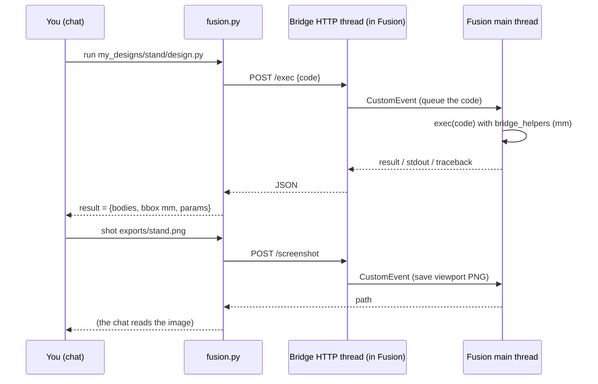

# Architecture: how a chat drives Fusion

## The short answer to "what does the user need?"

* **Fusion must be running** on the same computer, signed in. Minimised is fine. Nothing works when it is closed:
  the code that builds your part runs *inside Fusion*.
* **This is not an MCP server.** It is a Fusion **add-in** (`CopilotBridge/`) that starts with Fusion and listens on
  `127.0.0.1:8787` (your computer only), plus one command-line tool (`scripts/fusion.py`) that the chat calls. Any
  chat that can run a command on your computer can use it: Claude Code, GitHub Copilot in Agent mode, the Copilot
  app. An MCP wrapper over the same HTTP would be a thin extra layer; it is on the backlog, not needed today.
* **One Fusion, one account, one main thread.** Fusion signs one account into one session at a time (a Fusion left
  open on another computer blocks this one with an *Active Sessions Exceeded* dialog). All API calls run on Fusion's
  main (UI) thread, so a **modal dialog stops everything** until it is dismissed.

## The pieces

```text
you  <-- chat -->  Claude Code / GitHub Copilot / Copilot app
                         |  runs a command
                         v
                 scripts/fusion.py  (doctor, install, launch, ping, new, run, exec, shot, export, dialog)
                         |  HTTP POST http://127.0.0.1:8787/exec  {code}
                         v
      +-------------------------------- Autodesk Fusion (process) --------------------------------+
      |  CopilotBridge add-in (AddIns/CopilotBridge -> junction -> this repo's CopilotBridge/)      |
      |    HTTP server thread  --fires CustomEvent-->  main thread: exec(code, namespace)            |
      |    namespace = adsk.core / adsk.fusion + bridge_helpers.* (reloaded on every call, mm API)  |
      |    returns result / stdout / traceback as JSON; /screenshot saves a PNG of the viewport     |
      +-------------------------------------------------------------------------------------------+
                         |
                         v
            exports/*.stl *.step *.f3d  (your disk; git-ignored)   screenshots (read by the chat)
```



## What each layer does

**`CopilotBridge/CopilotBridge.py`** (the add-in; loaded by Fusion at start-up, `runOnStartup` in the manifest):
starts a tiny HTTP server on `127.0.0.1`, port 8787 (falls back to 8788-8796 when taken, and writes the port it got to
`bridge/port.txt`). `POST /exec` receives Python source, hands it to the main thread through a Fusion `CustomEvent`,
waits (default 30 s) and returns `result` (whatever the script assigned to `result`), captured `stdout`, or the
traceback. `GET /ping` returns Fusion's version, the bridge version, the active document and product type.
`POST /screenshot` saves the viewport to a PNG. A singleton guard and `allow_reuse_address = False` keep a second
copy of the add-in (Fusion sees the junction twice) from starting a second server. The default modelling orientation
is set to Z-up once at start-up.

**`CopilotBridge/bridge_helpers.py`** (the API your scripts use; reloaded from disk on every `/exec`, so editing it
needs no Fusion restart): `new_design`, `sketch_on`, `prect`, `circle`, `mrect`, `extrude`, `revolve`, `fillet_all`,
`shell`, `hole_at`, `combine`, `pattern_*`, `mirror_body`, `add_param` / `set_param`, `body_info`, `export_stl` /
`export_step` / `export_f3d`, `screenshot`... All lengths **in millimetres**; Fusion's internal centimetres never
reach your script. The full list with signatures: [fusion_reference.md](fusion_reference.md#the-helper-api).

**`scripts/fusion.py`** (stdlib only; runs in your Python, not Fusion's): `doctor` (one table: installed, linked,
running, answering), `install` (a directory junction from Fusion's AddIns folder to this repo's `CopilotBridge/`),
`launch`, `ping`, `new <name>` (copies the template into `my_designs/<name>/`), `run <design.py>`, `exec "<code>"`,
`info`, `shot <png>`, `export <name>`, `dialog` (dismiss a modal dialog with `fusion_dialog.ps1`). Exit codes: 0 OK,
1 failed, 2 Fusion unreachable or blocked.

**`scripts/fusion_dialog.ps1`** (Windows): UI Automation to read and click Fusion's modal dialogs (`-Click Continue`,
`-Select 'Suspend*'`), because a dialog blocks the main thread and therefore every bridge call.

## Why not an MCP server, really

Fusion's Python API is only available to code running **inside Fusion's process** (add-ins and scripts), and only
on its main thread. Whatever protocol sits outside, something inside Fusion must receive code or commands and run
them there: that is the add-in. HTTP on localhost is the simplest thing both Fusion's embedded Python (3.14) and any
outside tool speak. An MCP server would be a separate process translating MCP tool calls into these same HTTP calls;
useful for chats that cannot run shell commands, redundant for the ones this repo targets. If it is built, it goes in
`scripts/` and the add-in does not change.

## Security posture

The bridge executes arbitrary Python inside Fusion for anyone who can reach `127.0.0.1:8787` on your computer. It
binds to the loopback interface only and has no authentication; it is meant for a single-user computer running a
chat you trust. Do not forward the port. Closing Fusion stops it.
