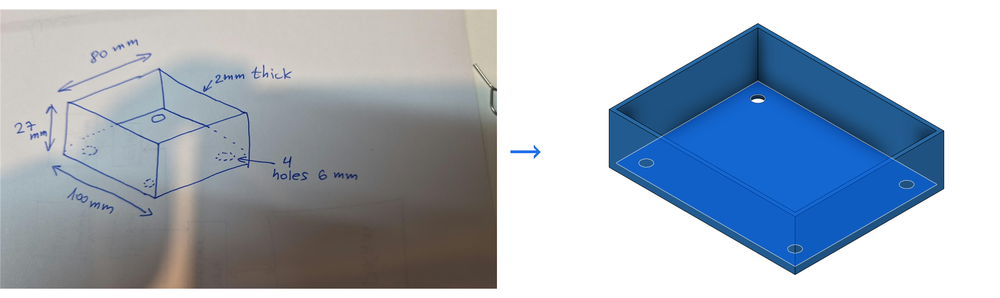

# 06_sketched_box - from a paper note to an object

The owner drew a box on paper, photographed it with a phone and dropped the photo into the chat
with one line: *"The next example is read from paper sketch and design."* In the same chat session
the tray below existed in Fusion, checked by numbers and by eye, with its archive exported. This
is the first run of the `sketch-to-design` skill on a real hand drawing; nothing in it was typed
into Fusion by a human.



Not a Babook lesson: the course (https://babook.co.il/courses/fusion360/) teaches sketch, extrude
and shell by hand in lessons 2 and 5; this example uses the same three operations from a script,
starting from a drawing instead of a lesson plan.

## 1. The paper note (what was read, not guessed)

`media/brief.jpg` is the photo, rotated upright (the paper was photographed turned 90 degrees).
An isometric drawing of a box seen from above, with:

| Written on it | Belongs to |
|---|---|
| `100 mm` | the long lower edge |
| `80 mm` | the short edge receding to the right |
| `27 mm` | the vertical edge: height |
| `2mm thick` | an arrow at the top rim: wall (and floor) thickness |
| `4 holes 6 mm` | an arrow at a dashed circle; three dashed circles and one solid one are drawn |

What was **not** on it, and had to be asked: whether the top is open (the inner lines suggested it),
where the four holes are (the dashed circles sit low on the walls, as hidden lines do) and how far
from the edges, and whether the corners are rounded.

## 2. The spec (agreed in chat before any code)

Three questions, one at a time, each with a recommended answer; the owner took the recommendation
each time:

1. open-top tray, four holes in the floor near the corners (not a closed box, not side-wall holes)
2. hole centres 10 mm from the outer edges (the sketch gives no number: marked GUESS)
3. spec v1 OK: outer 100 x 80 x 27 mm, open top, 2 mm walls and floor, 4 x dia 6 through-holes in
   the floor at 10 mm from the edges, sharp corners

| Parameter | Value | From |
|---|---|---|
| `length` | 100 mm | the sketch |
| `width` | 80 mm | the sketch |
| `height` | 27 mm | the sketch |
| `wall` | 2 mm | the sketch ("2mm thick") |
| `hole_d` | 6 mm | the sketch ("4 holes 6 mm") |
| `hole_inset` | 10 mm | GUESS, confirmed in chat |

Up: the floor lies on XY at z = 0, the open top faces +Z.

## 3. The script

```text
python scripts\fusion.py run examples\06_sketched_box\design.py
```

Five features, in the order a person would do them by hand: a centred rectangle `length x width`
on XY, extruded `height` up; `shell` from the top face by `wall`; four circles of `hole_d` on the
XY plane (the underside of the floor) at `+-(length/2 - hole_inset), +-(width/2 - hole_inset)`,
cut upward through `wall`. The rectangle, the extrude and the shell stay linked to the parameters
(change `height` in Fusion and the tray grows); the hole positions are numbers computed from the
parameters when the script runs, because `circle()` is a numeric helper (see "What it taught").

## 4. What was verified (Fusion 2706.1.14, 2026-10-27)

| Check | Expected from the spec | `result` / seen |
|---|---|---|
| bounding box | x -50..50, y -40..40, z 0..27 mm | `[-50, -40, 0]` .. `[50, 40, 27]` |
| volume | 216 - 182.4 (cavity) - 0.226 (4 holes) = 33.374 cm3 | `33.3738` cm3 |
| faces | 11 for an open shelled box + 4 hole cylinders = 15 | `15` (a hole that stopped short would add a floor face each) |
| parameters | six, word names | `length, width, height, wall, hole_d, hole_inset` |
| by eye, isometric | the drawing's view: one hole visible at the far corner, three hidden behind the near walls | `media/iso.png`: one hole visible, three shown as hidden edges, exactly the drawing's one solid + three dashed circles |
| by eye, top and bottom | four holes 10 mm in from the corners, 2 mm rim | `media/top.png`, `media/bottom.png` |
| archive | `sketched_box.f3d` re-opens with the same body and parameters | re-imported: `33.3738` cm3, 15 faces, 6 parameters, 5 timeline features |

## Status

| Step | Done | Evidence |
|---|---|---|
| brief saved and read back to the owner | [x] | `media/brief.jpg`; the read-back in section 1 was answered in chat, 2026-10-27 |
| spec v1 agreed before the script | [x] | three `ask_user` answers, section 2 |
| built in Fusion through the bridge | [x] | `fusion.py run`, first run, one body `Tray` |
| checked by numbers | [x] | the table above: bounding box, volume and face count match the spec |
| checked by eye against the drawing | [x] | `media/paper_to_object.png`: same view, same orientation (100 along the lower edge), same hidden-line pattern |
| exported | [x] | `sketched_box.f3d` (committed, 138 kB, re-opened once); `exports\sketched_box.stl` 30 kB and `.step` 20 kB (not committed; `fusion.py export sketched_box` rebuilds them) |
| printed | [ ] | not yet; 2 mm walls and sharp corners are printable as drawn, but nobody has printed this one |

## What it taught this repo

- Reading a photo of a sketch works when you read it **in order**: views and up-direction, every number
  with its edge, shapes, then the gaps; and when every gap becomes one question with a recommended answer.
  The owner's three answers took under a minute.
- A hand drawing's **dashed circles are hidden lines**: the three dashed holes sat low on the walls, where a
  floor hole shows through a wall in an isometric view, and Fusion's own isometric reproduced the pattern.
  Trust the convention before guessing "holes in the walls".
- `circle()`, `hole_at()` and `pattern_rect()` are **numeric** helpers; `prect()`, `extrude()` and `shell()`
  take expressions. A design that must stay fully parametric needs a parametric circle (backlog, Epic 2);
  until then compute the numbers with `eval_mm("length/2 - hole_inset")` so they at least follow the
  parameters at build time.
- Cutting holes from the **underside** (`sketch_on("xy")` at z = 0, `extrude(..., "wall", "cut", toward=(0, 0, 1))`)
  avoids sketching on a face, whose sketch axes may not be the model's; the face count proves the cut went through.
- In a script run through the bridge, the helpers' private names are not there: `_app` raised `NameError`;
  use `app`, `design()`, `root()` as the skills show (gotcha 16).
