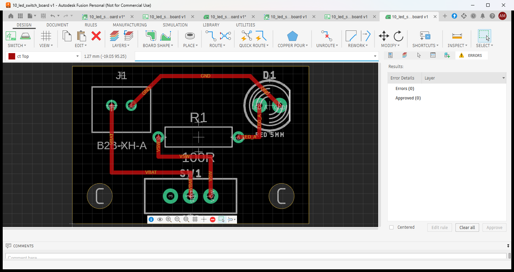
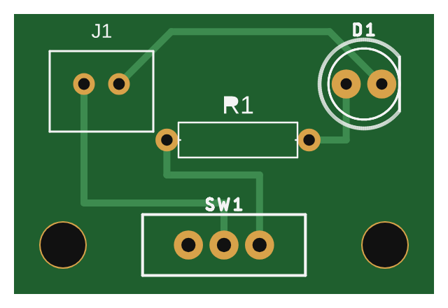
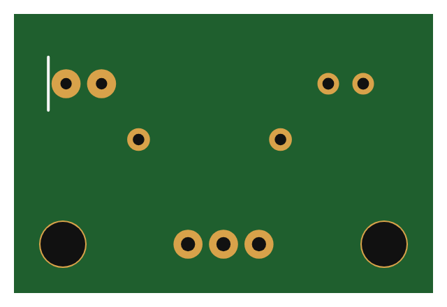

# 10 LED switch board: the first board from the chat

A battery connector, a slide switch, a resistor and an LED on a small two-layer board, then a printed case
around it. The smallest real board that walks the whole road once: parts from the library, schematic, electrical
check, board, design-rule check, factory files, the board in 3D, a case that fits. Not from a Babook lesson: it
opens the electronics stage (the 3D course is on Babook, https://babook.co.il/courses/fusion360/).

Status: in progress (schematic, board, every check and the factory files done; order, 3D board and case next).

```text
J1 (battery, JST XH 2-pin) --VBAT-- SW1 (slide, SPDT) --VSW-- R1 100R --LED_A-- D1 (5 mm LED) --GND-- J1
```

## Parts (all from Fusion's own libraries, all with a 3D model; found with `scripts/fusion_parts.py`)

| Ref | Part, as `ADD` names it | Value | Why this one |
|---|---|---|---|
| J1 | `B2B-XH-A@Connector` | B2B-XH-A | JST XH, top entry, MPN `B2B-XH-A(LF)(SN)`, status ACTIVE; the usual battery-pack plug |
| SW1 | `SWITCH-SPDT-PTH-11.6X4.0MM@SparkFun-Switches` | SPDT | SparkFun COM-00102 slide switch, through-hole; its second throw (pin S) stays free. The TE `1825159-1@Switches` was rejected: "pending discontinuance", and its prefix is U |
| R1 | `RESISTOR_AXIAL-10.16MM-PITCH@Tinkercad` | 100R | axial, 10.16 mm pitch. Fusion's own `R-USAXIAL-7.2MM-PITCH_@Resistor` crashes the ADD command (gotcha 22) |
| D1 | `LED5MM@SparkFun-LED` | RED 5MM | 5 mm through-hole LED; pins A and C |

R1 = 100 ohm suits two AA cells (3 V) and a red LED: (3.0 - 2.0) V / 100 ohm = 10 mA.

## Build and check

```powershell
python scripts\fusion.py run examples\10_led_switch_board\circuit.py 120   # 1. schematic (new design)
python scripts\fusion.py run examples\10_led_switch_board\board.py 120     # 2. board, on the same design
python scripts\fusion.py run examples\10_led_switch_board\factory.py 300   # 3. Fusion's checks, save, export, Gerbers
python scripts\pcb_check.py examples\10_led_switch_board\fusion\board.brd  # 4. our board check (no Fusion)
python scripts\factory_check.py examples\10_led_switch_board\factory       # 5. the simulated factory (no Fusion)
```

What is in the folder: `fusion/board.sch` + `board.brd` (Fusion's EAGLE export, what the checks read),
`checks.json` (the intended nets, the free pin, the accepted findings with reasons), `factory/` (the Gerber and
drill files from Fusion, the BOM and pick-and-place, previews; `board_gerbers.zip` is rebuilt by step 5).
How the checks work: [docs/procedures/board_checks_and_factory.md](../../docs/procedures/board_checks_and_factory.md).



What the factory receives, drawn from the Gerbers alone (top, then bottom as seen from below):




## Status

| Step | Done |
|---|---|
| Parts found in Fusion's libraries, each with a 3D model | 2026-11-16, Fusion 2706.1.17 |
| Schematic from the chat: 4 parts, 4 nets drawn as one visible loop, read back equal to the spec, looked at ([media/schematic.png](media/schematic.png)) | 2026-11-16 |
| Electrical rules check (ERC) clean: Fusion's ERC found 0 (first run: "SW1 has no value", "D1 has no value"; values added) | 2026-11-17 |
| Board: 30 x 20 mm outline, parts placed, two M3 holes, routed; 0 airwires read back and in Fusion's inspector, looked at ([media/board.png](media/board.png)) | 2026-11-16 |
| Fusion's board check clean (errors panel empty) | 2026-11-17 |
| Our board check (`pcb_check.py`, JLCPCB's limits): netlist equal to the intent, board equal to the schematic, all routed, 0 errors, 0 warnings, 3 approved (R1's library silkscreen) | 2026-11-17 |
| Factory files from a CAM job (9 Gerber layers, 1 drill file), checked outside Fusion (`factory_check.py`): outline 30 x 20 mm, 11 holes all accounted for, simulated electrical test equal to the schematic (no opens, no shorts), mask on every pad, smallest copper gap 0.606 mm; BOM, pick-and-place, zip | 2026-11-17 |
| Ordered from a fab (its own review, a real electrical test) | not yet (a human step: upload `board_gerbers.zip`) |
| 3D PCB, and a case around it | not yet |
| Soldered, lit; case printed and fitted | not yet (human steps) |

## What it taught this repo

* Electronics writes are EAGLE commands, checked by reading back (gotcha 17); a wrong library name places nothing.
* `VALUE` on a part with a fixed value asks a blocking question (gotcha 21); `SET CONFIRM YES` answers it, so every
  part gets a value: the ERC calls a missing one an error, and the BOM needs it.
* A part whose technology is `_` crashes Fusion's ADD (gotcha 22); `fusion_parts.py` flags them.
* The board editor starts on a mil grid (gotcha 24); deleting through the API broke Fusion (gotcha 25).
* Fusion's router keeps its own rules: the corner it moved to 1.27 mm from the edge is its 1.02 mm Board Outline
  Clearance plus half the track (gotcha 26). It also refuses rule-breaking wires and holes without a word
  (gotcha 29), so Fusion staying quiet is not proof: our own check on the exported files is.
* `DRC` only opens Fusion's rule dialog (gotcha 27); *Check Design Rules* checks, but `Board.checked` never turns
  true (gotcha 32).
* Factory files need a saved design and land in an odd folder (gotcha 28); a rebuilt design saved under the same
  name made a twin (gotcha 30).
* The Gerbers showed what the design did not: thick silkscreen arcs are hatched with hairlines (gotcha 31), and the
  M3 holes go into the plated drill file (gotcha 33; approved: plated is fine for a screw).
* SparkFun's parts print their names 0.61 mm high, below the fab's 1.0 mm; `brd_name_size(1.0)` fixes them.
  Tinkercad's R1 draws 0.12 mm silkscreen lines touching its pads; approved for now, our own library (backlog
  E3.5) will fix it at the source.
* A schematic is for people: the first version joined the parts only by matching net labels, and the owner saw
  "just components spread around". Small circuits are drawn as visible wires, with corners chosen from the pins'
  read-back positions so no wire passes another pin; the netlist check catches a wrong join.
