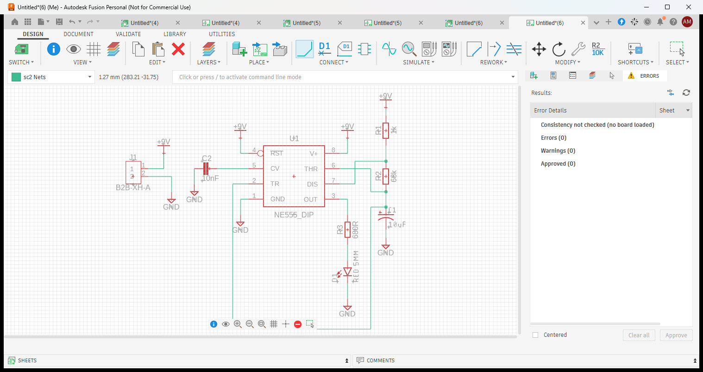
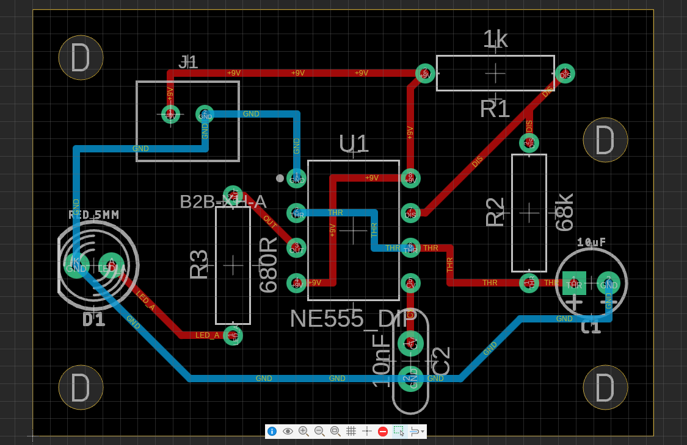

# 11 Blinker 555: the first board with a chip

A 555 timer blinks a red LED about once a second, from a 9 V battery. Board 10 walked the road once with
nets of two pins; this board's nets join three, four and five pins, it has a chip with eight pins, a part with
a plus and a minus (the 10 uF capacitor), and a schematic that uses power symbols. Not from a Babook lesson
(the 3D course is on Babook, https://babook.co.il/courses/fusion360/).

Status: in progress. The owner reviewed and moved the placement by hand on 2026-11-18, and the board was
routed again on 45 x 31 mm, saved, and its factory files made: Fusion's board check, ours and the simulated
factory report 0 errors. Still to do: the owner's approval of the ERC finding and the warnings, then it can
be ordered.

```text
+9V -- R1 1k -- DIS -- R2 68k -- THR -- C1 10uF -- GND          U1 = NE555: pin 7 DIS, pins 6 and 2 THR
U1 pin 3 (OUT) -- R3 680R -- D1 red LED -- GND                  pin 5 CV -- C2 10nF -- GND
pins 4 (reset) and 8 (V+) to +9V; pin 1 to GND
```

Blink rate: f = 1.44 / ((R1 + 2 R2) C1) = 1.44 / (137 kohm x 10 uF) = 1.05 Hz, the LED on about 51 % of
each period (the textbook formula; the real rate depends on C1's tolerance, 20 %). LED current:
(9 V - 1.7 V out drop - 2 V LED) / 680 ohm, about 8 mA (rough: the NE555's high output sits 1.4 to 2 V
below +9V).

## Parts (all from Fusion's own libraries, found with `scripts/fusion_parts.py`)

| Ref | Part, as `ADD` names it | Value | Why this one |
|---|---|---|---|
| J1 | `B2B-XH-A@Connector` | B2B-XH-A (fixed) | the JST XH 2-pin header from board 10, for the 9 V battery clip's leads |
| U1 | `NE555_DIP@IC_Clock-Timing` | NE555_DIP (fixed) | Texas Instruments NE555P, DIP-8, PART_STATUS Active, 3D model |
| R1, R2, R3 | `RESISTOR_AXIAL-10.16MM-PITCH@Tinkercad` | 1k, 68k, 680R | the axial resistor from board 10 |
| C1 | `10UF-POLAR-RADIAL-2.5MM-25V-20%@SparkFun-Capacitors` | 10uF | electrolytic, 25 V (above 9 V with margin), pins `+` (pad 1) and `-` (pad 2) |
| C2 | `CAPACITORCERAMIC-2.54MM@Tinkercad` | 10nF | ceramic, 2.54 mm pitch |
| D1 | `LED5MM@SparkFun-LED` | RED 5MM | the 5 mm LED from board 10 |
| P1-P4, G1-G5 | `+9V@Power_Symbols`, `GND@Power_Symbols` | +9V, GND | power symbols: schematic only, no footprint |

## Build

```powershell
python scripts\fusion.py run examples\11_blinker_555\circuit.py 180    # 1. schematic (new design)
python scripts\fusion.py run examples\11_blinker_555\board.py 180      # 2. outline, holes, placement; the owner reviews
python scripts\fusion.py run examples\11_blinker_555\route.py 180      # 2b. tracks, once the owner agrees
python scripts\fusion.py run examples\11_blinker_555\factory.py 300    # 3. Fusion's checks, save, export, Gerbers
python scripts\pcb_check.py examples\11_blinker_555\fusion\board.brd  # 4. our board check, no Fusion needed
```



The board, 45 x 31 mm, with the owner's placement: top copper red, bottom blue, four M3 holes (the
fourth beside R2, which saved an empty strip along the top). Pins 4 and 8 (+9V) and pins 2 and 6 (THR) both cross under the 555, diagonally, one link on each layer; no vias.



## Status

| Step | Done |
|---|---|
| Parts found in Fusion's libraries (NE555 Active with a 3D model, the electrolytic with marked + and -) | 2026-11-18, Fusion 2706.1.17 |
| Schematic from the chat: 8 parts, 9 power symbols, 7 nets; the netlist read back equal to the intent on the first run; looked at ([media/schematic.png](media/schematic.png)): one crossing (pin 6 over pin 7's wire, no dot), every other join a dot | 2026-11-18 |
| Electrical rules check (ERC) | ran 2026-11-18: one finding, "POWER pin U1 V+ connected to +9V" (the 555's supply pin is named V+, its net +9V); to be approved in Fusion with that reason: not yet |
| Board, first try: 50 x 40 mm, routed on both layers | 2026-11-18: 0 unrouted, no copper off the two layers; Fusion's board check 0 errors; looked at ([media/board.png](media/board.png)) |
| Placement reviewed and moved by the owner in Fusion, agreed; routed again (`route.py`); board shrunk to 45 x 31 mm with the fourth hole beside R2 | 2026-11-18: 0 unrouted, Fusion's board check 0 errors, looked at ([media/board.png](media/board.png)) |
| Our board check (`pcb_check.py`) on the export | 2026-11-18, again on the 45 x 31 board: 0 errors; the netlist equals the intent in `checks.json`; 8 silkscreen warnings (thin lines in the Tinkercad resistor and NE555 footprints, marks near pads), not yet approved |
| GND copper pour | not yet |
| Saved to the Fusion cloud, Gerbers and drill file, `factory_check.py` | 2026-11-18, after a clean rebuild (circuit, board, route) in a new design, once the owner had freed editable documents: saved, 10 factory files, `factory_check.py` 0 errors, the bare-board e-test equal to the schematic (7 nets, no opens, no shorts); 13 warnings (4 screw holes plated, silkscreen of the library footprints, no LCSC numbers) wait for the owner's approval |
| Ordered, soldered, blinking | not yet (human steps) |

## What it taught this repo (so far)

* **A fix verified on the wrong case.** Gotcha 21 said `SET CONFIRM YES` answers "Part J1 has no user
  definable value. Change it anyway?"; it was checked on D1, which never asks. On J1 the question still came.
  Now `sch_place` reads `deviceset.userValue` first and refuses, instead of hanging Fusion; fixed-value parts
  (J1, U1) simply keep their library value.
* **Power symbols ask for their name** on every placement (gotcha 35). A value inside the ADD command made
  Fusion report an internal error; what works is a watcher: `sch_place` starts `fusion_dialog.ps1` in the
  background, which waits for that one "Value" box and clicks OK, and leaves every other dialog alone.
* **A net of many pins** is several `NET` wires with the same name; GND here is five pins and five symbols.
* **Some crossings cannot be avoided**: with the 555's pins in their fixed order, pins 2 and 6 must meet
  while pin 7 lies between them. A crossing without a dot is not a connection; the netlist check proves it.
* `scripts/fusion_window_shot.ps1` takes the screenshot `fusion.py shot` cannot take in the electronics
  editors (gotcha 18).
* **The bottom copper is layer 304, not 16** (gotcha 37). The first routing put GND and a THR link on an inner
  layer: Fusion showed zero-length airwires at every pad, while the exported file and our check looked perfect.
* **`ROTATE =R90 R1` turns nothing**: R1 is read as an angle (gotcha 36). **Route pad to pad**: tracks ending
  on another track's corner raised Fusion's "unexpected condition" box (gotcha 38).
