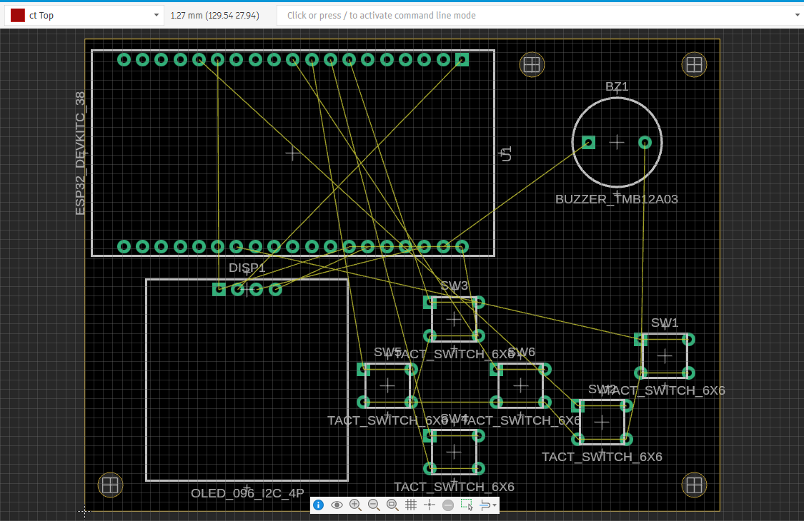
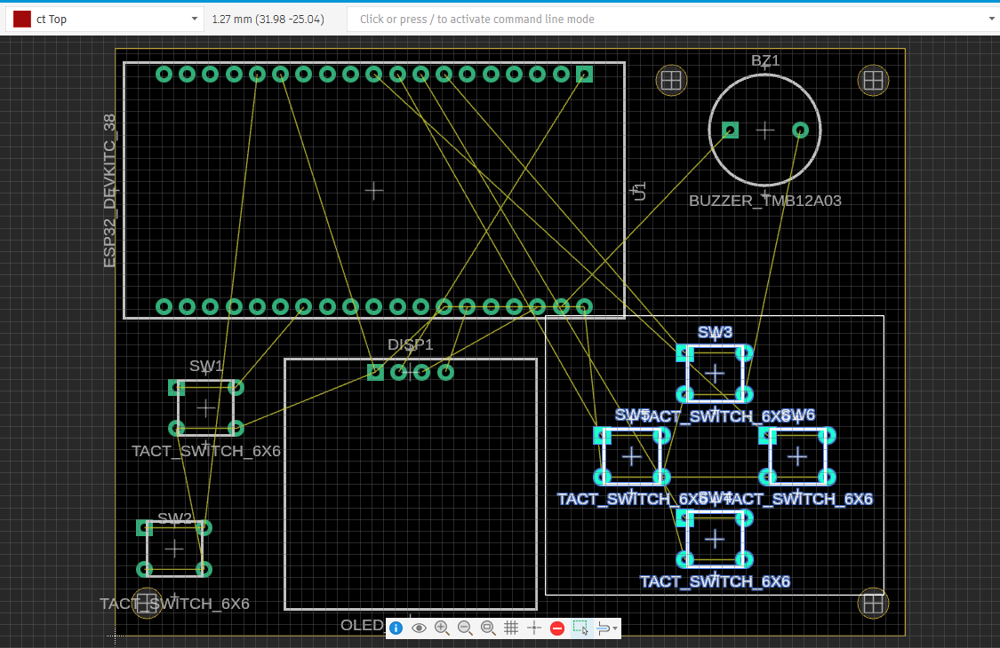
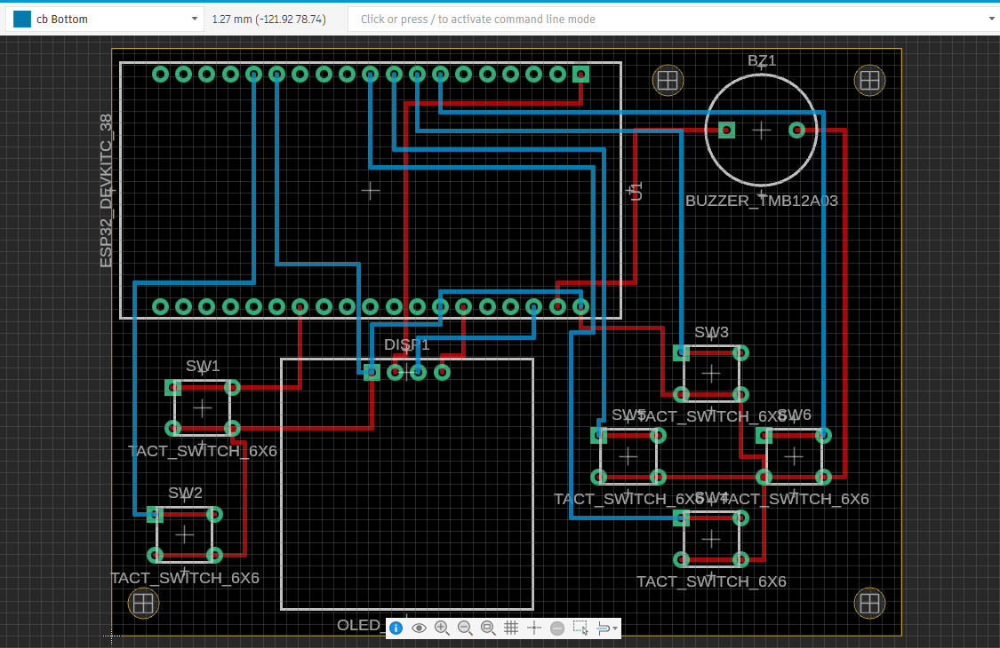
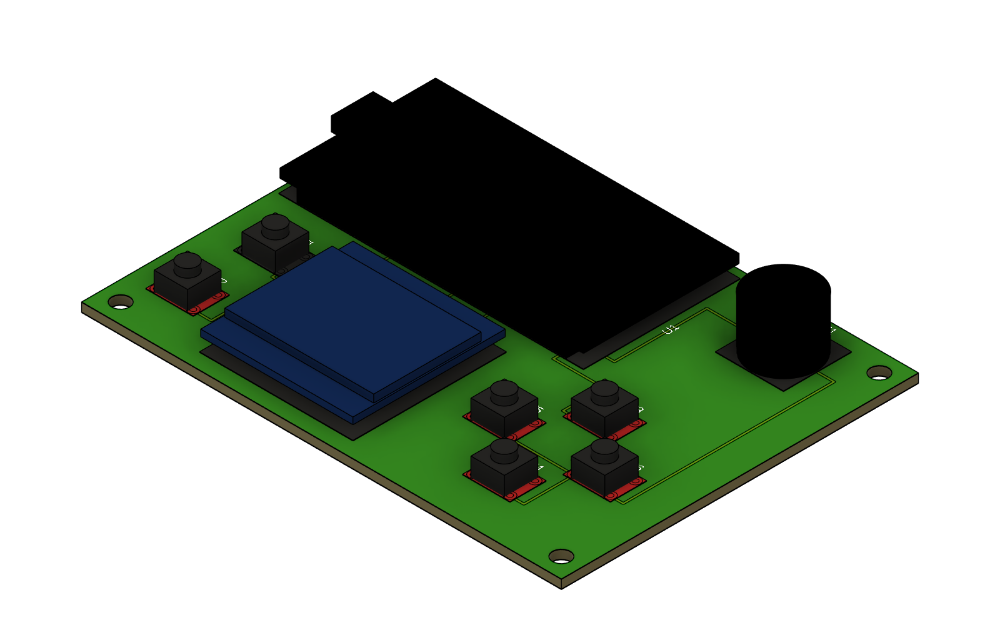
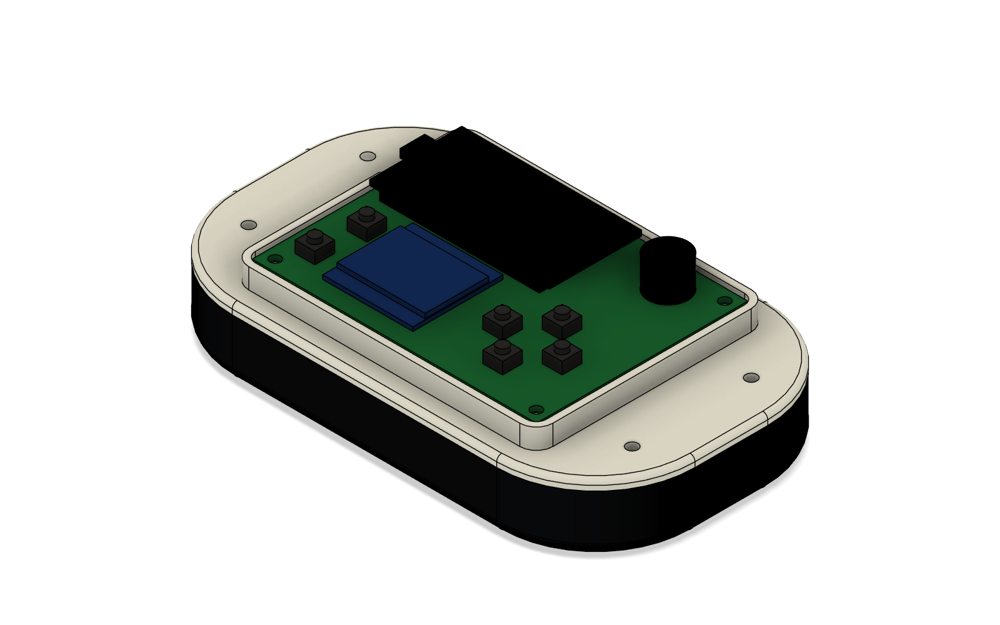
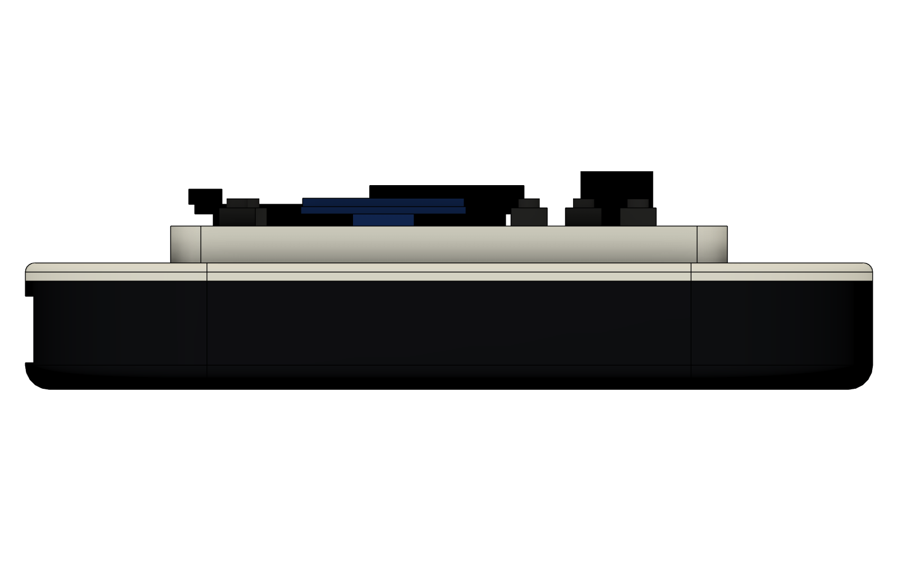
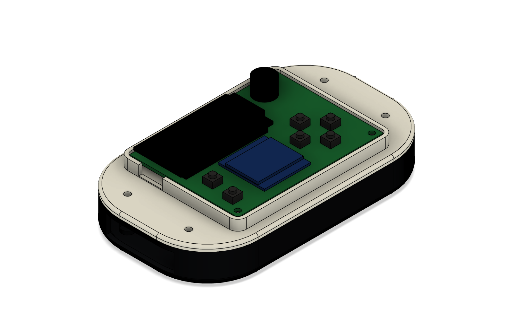
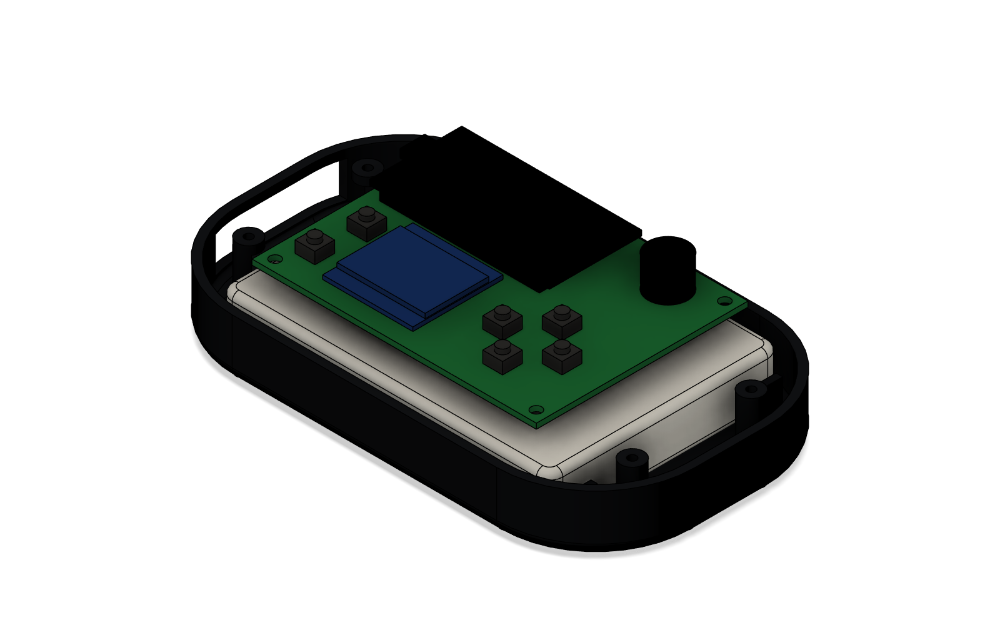
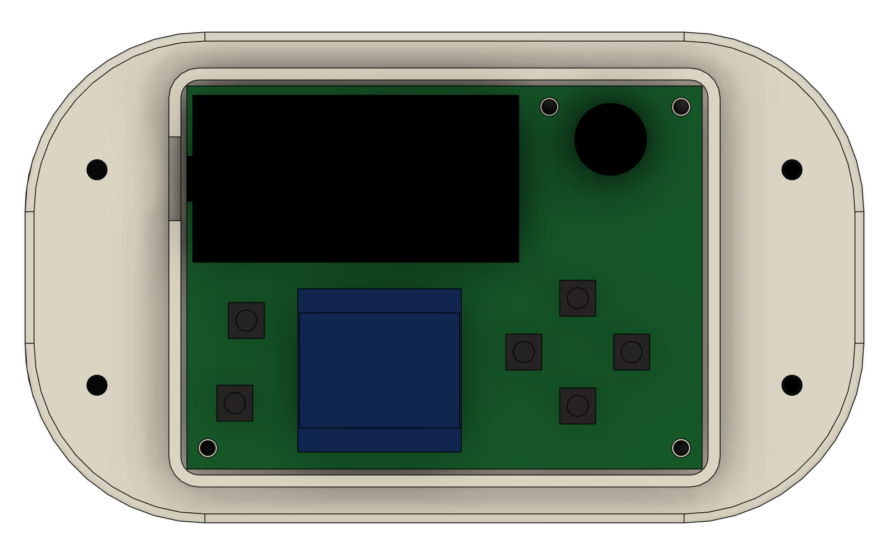

# 12 Tiny Arcade: a game board from the owner's own parts, then its 3D model and its box

The Single Button kit ([SingleButtonKitBKM](https://github.com/avisalmon/SingleButtonKitBKM): an ESP32, a
0.96 inch screen, a button and a buzzer on a breadboard) as a small circuit board with six buttons: A, B and
a direction pad. Every part comes from the owner's library ([library/avi_salmon](../../library/README.md)),
real parts from his store with their pins confirmed on the part. The kit's pins are kept, so its programs
(Flappy) run unchanged. One flow: **board, then the board in 3D, then a 3D-printed box**, with two reviews
by the owner: the placement, and the printing concept.

Status: in progress. The board is done: the owner's placement (2026-11-19), routed on two layers with no
vias; Fusion's checks, our checks and the simulated factory all pass with 0 errors; the factory files are made
([summary page](index.html)). The board is in 3D, each part from its library model. The case is drawn around
it with a power bank underneath (first version 2026-11-20, from assumed sizes, waiting for the owner's review).
Not yet: real measurements of the bank and the parts, a print, an order.

| Part | Pin on the ESP32 | Note |
|---|---|---|
| screen SCL / SDA, VCC, GND | G22 / G21, 3V3, GND | the kit's pins |
| buzzer + / - | G23 / GND | the kit's pin |
| A, B | G4, G13 | A is the kit's one button |
| UP, DOWN, LEFT, RIGHT | G33, G26, G25, G32 | chosen so the four tracks reach the direction pad without crossing |

Each button's other contact goes to GND; the program turns on the pin's internal pull-up (released 1,
pressed 0), so there are no resistors. Pins avoided: 0, 2, 5, 12, 15 (they decide how the ESP32 starts),
1 and 3 (USB serial), 6-11 (flash), 34-39 (input only, no internal pull-up).

## Parts (the owner's library)

| Ref | Part | Library |
|---|---|---|
| U1 | ESP32 DevKitC, 38 pins | [esp32_devkitc_38](../../library/avi_salmon/esp32_devkitc_38/part.json) |
| DISP1 | OLED 0.96 inch, I2C, 4 pins | [oled_096_i2c](../../library/avi_salmon/oled_096_i2c/part.json) |
| BZ1 | buzzer TMB12A03 | [buzzer_tmb12a03](../../library/avi_salmon/buzzer_tmb12a03/part.json) |
| SW1-SW6 | tact switch 6 x 6 mm | [tact_switch_6x6](../../library/avi_salmon/tact_switch_6x6/part.json) |

## Build

```powershell
python scripts\fusion.py run examples\12_tiny_arcade\circuit.py 300   # 1. schematic (new design)
python scripts\fusion.py run examples\12_tiny_arcade\board.py 300     # 2. outline, holes, placement; the owner reviews
python scripts\fusion.py run examples\12_tiny_arcade\route.py 300     # 2b. tracks, once the owner agrees
python scripts\fusion.py run examples\12_tiny_arcade\factory.py 600   # 3. Fusion's checks, save, export, Gerbers
python scripts\pcb_check.py examples\12_tiny_arcade\fusion\board.brd  # 4. our board check, no Fusion needed
python scripts\factory_check.py examples\12_tiny_arcade\factory       # 5. the simulated factory
python scripts\fusion.py run examples\12_tiny_arcade\board3d.py 300   # 6. the board in 3D, the parts on it
python scripts\fusion.py run examples\12_tiny_arcade\case.py 600      # 7. the case around the board and the bank
```


The first placement proposal, then the owner's (a console: A and B left, the screen in the middle, the
direction pad right), then the routed board: top copper red, bottom blue.







The board in 3D, each part built from the model in its library record (boxes and cylinders, every size
with its source):



## The case (`case.py`)

The owner's brief (2026-11-20): rounded, modern, the power bank under the board, and the screen and buttons
left open so they are pressed and seen directly. Version 1 was a closed box with button caps; the owner
called it "too boxy", so it now lives only in git history. Version 2 is a rounded handheld, 140 x 82 mm and
21 mm thick to the deck, with the board on top (36 mm to the top of the buzzer). It is printed as two
parts, each flat and with no supports:

* **Body**: a rounded shell: corners of radius 30 seen from above, and a rounded bottom edge. The bank lies
  inside it, and ribs stop it sliding. The two ends are grips, so the thumbs land on A and B (left) and on
  the direction pad (right). A port bay in the left end shows the bank's ports and lights. It prints open
  side up.
* **Deck**: the lid. The board sits on four posts on it (4 x M3 x 8 from above, through the board's holes),
  inside a raised rim that guards its edges and is open at the ESP32's USB. Four M3 x 10 screws through the
  deck into columns in the grips hold the deck and the body together. It prints flat side down.

A short cable (10 cm) runs from the bank's port bay, over the left grip, to the ESP32's USB.

The board, its parts and the bank are in the design as reference bodies, and the script intersects every
printed part with every one of them: all 0 mm3. Version 1 proved the check: a part moved 0.5 mm into
another gave exactly the expected volume.











## Status

| Step | Done |
|---|---|
| Parts: the owner's library, each part's symbol and footprint placed in Fusion and read back | 2026-11-19, Fusion 2706.1.17 |
| Schematic from the chat: 9 parts, 10 supply symbols, 11 nets; the netlist read back equal to the intent; looked at ([media/schematic.png](media/schematic.png)): no wire crosses another | 2026-11-19 |
| The ESP32's GND pins (the "power" kind, no wire) on the board's GND signal | 2026-11-19: pads 14, 20 and 26 read back in GND |
| Placement, first proposal: 86 x 64 mm, four M3 holes | 2026-11-19: placed and looked at ([media/placement_proposal.png](media/placement_proposal.png)) |
| Placement reviewed and moved by the owner in Fusion (a console layout), read back into `board.py`; B moved 1.5 mm off the corner screw, agreed | 2026-11-19 ([media/placement_owner.png](media/placement_owner.png)) |
| Routed (`route.py`): two layers, no vias; the direction pins swapped so no tracks cross (UP G33, DOWN G26, RIGHT G32) | 2026-11-19: 0 unrouted, no copper off the two layers, looked at ([media/board.png](media/board.png)) |
| Fusion's checks | 2026-11-19: board check 0 errors; ERC 5 findings, unused ESP32 input pins (EN, SVP, SVN, G34, G35), approved in `checks.json` with that reason, **to be confirmed by the owner** |
| Our board check (`pcb_check.py`) and the simulated factory (`factory_check.py`) | 2026-11-19, after a clean rebuild in a new design: 0 errors; the netlist equal to the intent; the bare-board e-test equal to the schematic (11 nets, no opens, no shorts); open: 9 warnings, no part has a 3D model yet |
| Saved to the Fusion cloud (project "Tiny Arcade"), factory files | 2026-11-19 |
| The board in 3D, with the parts as 3D objects (`board3d.py`: each part's model from its library part.json, at its place on Fusion's 3D board) | 2026-11-19: built; each part's bounding box read back over its footprint; looked at ([media/board3d.png](media/board3d.png)). Heights above the board's underside: ESP32 8.7 mm (soldered straight on, 2026-11-20; it was 17.2 on female headers), buzzer 11.0, screen 6.6, buttons 6.5 (the 5 mm button is assumed): **to be measured** |
| The ESP32 soldered straight onto the board (no sockets), the owner's choice | 2026-11-20: `board3d.py` and `case.py` model it so; the ESP32's top is 7.2 mm above the board (from its model, not measured) |
| Printing concept: a power bank underneath, a short cable outside (the owner's direction); bank 100 x 70 x 15 mm (the owner's working size; the AliExpress listing's drawing says 93 x 63.5 x 14) | 2026-11-20 |
| The case, version 1 (a closed box, button caps) | 2026-11-20: built, 0 mm3 against every part; the owner: "too boxy" |
| The case, version 2 (`case.py`): a rounded handheld, the board open on top, the bank inside; body and deck | 2026-11-20: built in Fusion 2706.1.17; every printed part intersected with the board, every part on it and the bank: 0 mm3; looked at from five views (media/case_v2*.png). **Waiting for the owner's review**; the bank, the buttons, the screen and the buzzer are assumed sizes, **to be measured** |
| Printed, fitted | not yet |

## What it taught this repo (so far)

* **Check what a command added, not only what it was asked to add.** Every ADD from a local library left
  one more copy of the part at the sheet's edge, which took the next name the script wanted. `sch_place`
  now ends the ADD (`EDIT .s1`) and fails if anything else appeared (gotcha 48).
* **Our check learned the supply pins**: an ESP32 pin named GND@14 of direction "pwr" joins GND with no
  wire; Fusion's board did, our check's schematic did not, so they disagreed. `pcb_check.py` now joins such
  pins by name, as EAGLE does.
* **Silkscreen stops short of the pads** in generated footprints (a square pad 1 reaches out to its corners).
* **One pin on two pads** (the tact switch's joined legs) and **GND pins that join by name**: the board's
  signal has them, the schematic's nets do not list them.
