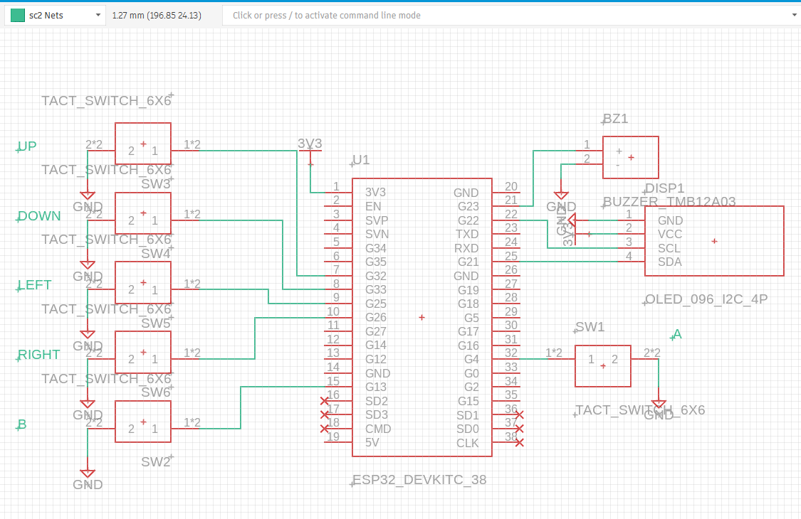

# 12 Tiny Arcade: a game board from the owner's own parts, then its 3D model and its box

The Single Button kit ([SingleButtonKitBKM](https://github.com/avisalmon/SingleButtonKitBKM): an ESP32, a
0.96 inch screen, a button and a buzzer on a breadboard) as a small circuit board with six buttons: A, B and
a direction pad. Every part comes from the owner's library ([library/avi_salmon](../../library/README.md)),
real parts from his store with their pins confirmed on the part. The kit's pins are kept, so its programs
(Flappy) run unchanged. One flow: **board, then the board in 3D, then a 3D-printed box**, with two reviews
by the owner: the placement, and the printing concept.

Status: in progress. The schematic is built and checked; the placement is a first proposal, waiting for the
owner's review. Not yet: routing, factory files, the 3D board, the box.

| Part | Pin on the ESP32 | Note |
|---|---|---|
| screen SCL / SDA, VCC, GND | G22 / G21, 3V3, GND | the kit's pins |
| buzzer + / - | G23 / GND | the kit's pin |
| A, B | G4, G13 | A is the kit's one button |
| UP, DOWN, LEFT, RIGHT | G32, G33, G25, G26 | |

Each button's other contact goes to GND; the program turns on the pin's internal pull-up (released 1,
pressed 0), so there are no resistors. Pins avoided: 0, 2, 5, 12, 15 (they decide how the ESP32 starts),
1 and 3 (USB serial), 6-11 (flash), 34-39 (input only, no internal pull-up).

## Parts (the owner's library)

| Ref | Part | Library |
|---|---|---|
| U1 | ESP32 DevKitC, 38 pins | [esp32_devkitc_38](../../library/avi_salmon/esp32_devkitc_38/part.json) |
| DISP1 | OLED 0.96 inch, I2C, 4 pins | [oled_096_i2c](../../library/avi_salmon/oled_096_i2c/part.json) |
| BZ1 | buzzer TMB12A03 | [buzzer_tmb12a03](../../library/avi_salmon/buzzer_tmb12a03/part.json) |
| SW1-SW6 | tact switch 6 x 6 mm | [tact_switch_6x6](../../library/avi_salmon/tact_switch_6x6/part.json) |

## Build

```powershell
python scripts\fusion.py run examples\12_tiny_arcade\circuit.py 300   # 1. schematic (new design)
python scripts\fusion.py run examples\12_tiny_arcade\board.py 300     # 2. outline, holes, placement; the owner reviews
```




## Status

| Step | Done |
|---|---|
| Parts: the owner's library, each part's symbol and footprint placed in Fusion and read back | 2026-11-19, Fusion 2706.1.17 |
| Schematic from the chat: 9 parts, 10 supply symbols, 11 nets; the netlist read back equal to the intent; looked at ([media/schematic.png](media/schematic.png)): no wire crosses another | 2026-11-19 |
| The ESP32's GND pins (the "power" kind, no wire) on the board's GND signal | 2026-11-19: pads 14, 20 and 26 read back in GND |
| Placement, first proposal: 86 x 64 mm, four M3 holes | 2026-11-19: placed and looked at ([media/placement_proposal.png](media/placement_proposal.png)); **waiting for the owner's review** |
| Routing, Fusion's checks, our checks, factory files | not yet |
| The board in 3D, with the parts as 3D objects | not yet |
| Printing concept (owner's review), the box, printed | not yet |

## What it taught this repo (so far)

* **Check what a command added, not only what it was asked to add.** Every ADD from a local library left
  one more copy of the part at the sheet's edge, which took the next name the script wanted. `sch_place`
  now ends the ADD (`EDIT .s1`) and fails if anything else appeared (gotcha 48).
* **One pin on two pads** (the tact switch's joined legs) and **GND pins that join by name**: the board's
  signal has them, the schematic's nets do not list them.
