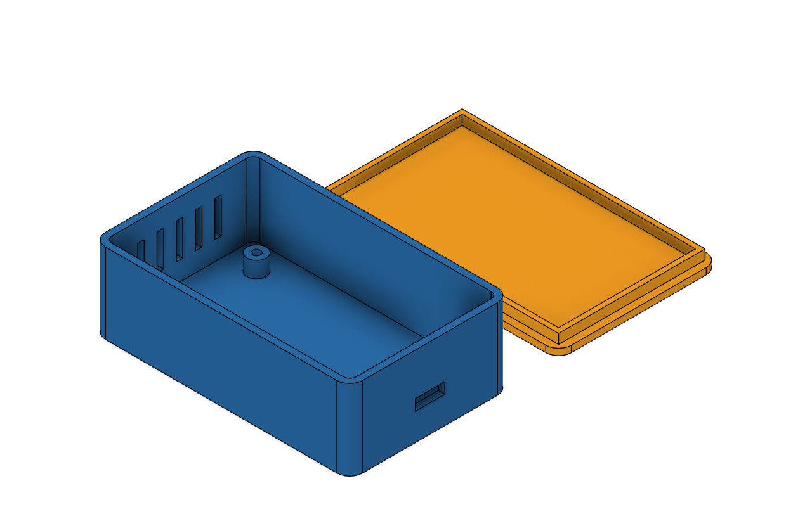

# parametric_box - the known-good template

An electronics enclosure: a shelled, rounded **base** with four M3 standoffs, a USB-C cutout and
vent slots, plus a separate **lid** with an inner lip that drops into the base. Every main
dimension is a Fusion **user parameter**, so after the script has run you (or the assistant) can
change `length` in *Modify > Change Parameters* and the whole box follows.

`python scripts\fusion.py new <name>` copies `design.py` into `my_designs\<name>\` as the
starting point for your own part.

## Parameters

| Name | Default | Meaning |
|---|---|---|
| `length` | 80 mm | outer length (X) |
| `width` | 50 mm | outer width (Y) |
| `height` | 25 mm | base height (Z) |
| `wall` | 2 mm | wall and floor thickness |
| `corner_r` | 4 mm | outer vertical-corner radius |
| `lid_t` | 2 mm | lid plate thickness |
| `lip_h` | 3 mm | height of the lip under the lid |
| `lid_gap` | 15 mm | layout gap between base and lid |

Fixed in the script (numbers, not parameters): standoff pitch 58 x 30 mm, standoff 6 mm dia x 5 mm,
pilot holes 2.5 mm (M3 self-tap), USB-C slot 9.2 x 3.4 mm, five vent slots 2 mm wide, lip
clearance 0.2 mm per side.

## What it teaches

- `add_param` + expression strings (`'length/2 + 1 mm'`) keep features linked to parameters.
- `prect` draws a centred rectangle; `sketch_on('yz', ...)` + `mrect` draw in **model** space
  so a side-wall cutout is placed by its real X/Y/Z.
- `fillet_all(body, radius, predicate)` picks only vertical edges.
- `shell(body, top_face(body), 'wall')` hollows the base from the top.
- Two bodies in one design, built apart so `join` never fuses them.
- The script ends with `result = {...}` so `fusion.py run` prints bodies and parameters:
  that is how the assistant checks the part by numbers, not by trusting the code.

## Status (what was actually done, and how we know)

| Step | Done | Evidence |
|---|---|---|
| Built in Fusion 2706.1.14 via `fusion.py run` | [x] | ran repeatedly during the build-up of this repo; bodies `Base` + `Lid` reported by `body_info()` |
| Checked by numbers | [x] | bounding box 80 x 50 x 25 mm (base), two bodies, 8 parameters listed |
| Checked by eye | [x] | `parametric_box.png`, `parametric_box_top.png` (this folder) |
| Parameter change re-flows the model | [x] | `parametric_box_resized.png` after `set_param('length', '120 mm')` |
| Exported STL / STEP / F3D | [x] | `exports\enclosure_base.stl`, `enclosure_lid.stl`, `enclosure.step`, `enclosure.f3d` were produced (git-ignored) |
| Printed and the lid fits | [ ] | not yet: nobody has printed it; the 0.2 mm clearance is a guess to confirm |
